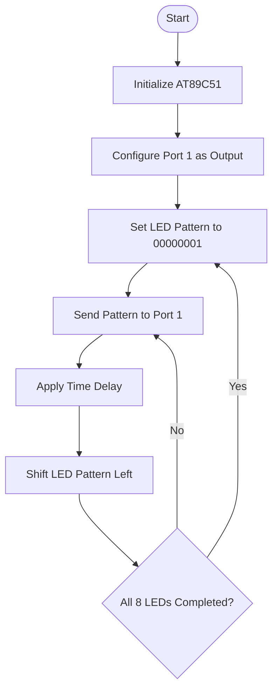

Here is a complete, GitHub-ready README.md for your project, including Author Details, Aim, Apparatus, Theory, Circuit Connections, Working Principle, Algorithm, Flowchart, Embedded C Program, Calculations, Proteus Simulation Procedure, Experimental Readings, Applications, and Result.

Writing

# 💡 Design and Implementation of an Eight-LED Sequential Lighting System Using AT89C51 Microcontroller

## Author Details

- **Author Name:** Your Name
- **Department:** Your Department
- **College:** Your College Name
- **Project Title:** Eight-LED Sequential Lighting System
- **Microcontroller:** AT89C51
- **Programming Language:** Embedded C
- **Simulation Software:** Proteus Design Suite

---

## 1\. Aim

To design and simulate an eight-LED sequential lighting system using the AT89C51 microcontroller in Proteus software. The system is designed to switch ON and OFF eight LEDs in a sequential pattern using Embedded C programming.

## 2\. Abstract

This project demonstrates the design and implementation of an eight-LED sequential lighting system using the AT89C51 microcontroller.

Eight LEDs are connected to one of the microcontroller's output ports. The LEDs are controlled through an Embedded C program that generates sequential output patterns.

When the program executes, the LEDs turn ON one after another with a predefined time delay, creating a running-light effect. The sequence repeats continuously.

The entire circuit is designed and simulated using Proteus Design Suite, while the Embedded C program is developed and compiled using Keil µVision IDE.

This project demonstrates digital output interfacing, bit manipulation, delay generation, and microcontroller-based LED control.

## 3\. Apparatus Required

| S.No. | Component | Specification | Quantity |
| --- | --- | --- | --- |
| 1 | Microcontroller | AT89C51 | 1 |
| 2 | LED | Red, 5mm | 8 |
| 3 | Resistors | 330 Ω | 8 |
| 4 | Crystal Oscillator | 11.0592 MHz | 1 |
| 5 | Capacitors | 33 pF | 2 |
| 6 | Reset Resistor | 10 kΩ | 1 |
| 7 | Reset Capacitor | 10 µF | 1 |
| 8 | Push Button | Normally Open | 1 |
| 9 | DC Power Supply | +5V | 1 |
| 10 | Connecting Wires | — | As required |
| 11 | Computer | For simulation and programming | 1 |

## 4\. Software Requirements

- Proteus Design Suite
- Keil µVision IDE
- Embedded C Compiler
- AT89C51 device library

## 5\. Theory

The AT89C51 is an 8-bit microcontroller belonging to the 8051 family. It is commonly used in embedded systems for controlling electronic devices and performing automation tasks.

The microcontroller consists of an 8-bit CPU, 4 KB of Flash program memory, 128 bytes of internal RAM, 32 programmable input/output pins, two 16-bit timers/counters, a serial communication port, and interrupt control circuitry.

In this project, the AT89C51 is used to control eight LEDs connected to Port 1.

Each LED is connected to an individual output pin through a current-limiting resistor. The microcontroller generates digital output signals to control the LEDs.

The Embedded C program generates a sequence of binary patterns. Each pattern activates one LED at a time, and a software delay is introduced between successive patterns.

For example, the binary output sequence is:

text

```text
00000001
00000010
00000100
00001000
00010000
00100000
01000000
10000000
```

Each binary pattern represents the activation of a different LED.

After the eighth LED is activated, the sequence starts again from the first LED.

This creates a continuous running-light effect.

## 6\. Description of Components

### 6.1 AT89C51 Microcontroller

The AT89C51 is an 8-bit microcontroller used for controlling electronic circuits.

**Features:**

- 8-bit CPU.
- 4 KB Flash memory.
- 128 bytes internal RAM.
- 32 programmable I/O pins.
- Two 16-bit timers/counters.
- Serial communication interface.
- Five interrupt sources.

In this project, Port 1 is used to control the eight LEDs.

### 6.2 Light Emitting Diode (LED)

An LED is a semiconductor device that emits light when forward biased.

It converts electrical energy into light energy.

The eight LEDs are connected to the microcontroller output pins and illuminate sequentially.

### 6.3 Current-Limiting Resistor

A resistor is connected in series with each LED to limit the current flowing through it.

This prevents excessive current from damaging the LED and microcontroller.

A typical resistor value used in this project is 330 Ω.

### 6.4 Crystal Oscillator

The crystal oscillator provides the clock signal required for the operation of the microcontroller.

An 11.0592 MHz crystal oscillator is used in this design.

### 6.5 Capacitors

Two 33 pF capacitors are connected with the crystal oscillator to provide the required oscillator circuit.

A 10 µF capacitor may be used in the reset circuit.

### 6.6 Power Supply

A regulated +5V DC power supply is provided to operate the AT89C51 and the LED circuit.

## 7\. Circuit Connections

The eight LEDs are connected to Port 1 of the AT89C51 microcontroller.

| AT89C51 Pin | Pin Number | Connection |
| --- | --- | --- |
| P1.0 | 1 | LED 1 |
| P1.1 | 2 | LED 2 |
| P1.2 | 3 | LED 3 |
| P1.3 | 4 | LED 4 |
| P1.4 | 5 | LED 5 |
| P1.5 | 6 | LED 6 |
| P1.6 | 7 | LED 7 |
| P1.7 | 8 | LED 8 |
| RST | 9 | Reset circuit |
| GND | 20 | Ground |
| XTAL1 | 19 | Crystal oscillator |
| XTAL2 | 18 | Crystal oscillator |
| VCC | 40 | +5V supply |

### LED Connections

- Connect the anode of each LED to its corresponding Port 1 output pin through a 330 Ω resistor.
- Connect the cathode of each LED to GND.
- Use a common ground for the entire circuit.

In this arrangement, a HIGH output activates the corresponding LED.

**Note:** Verify the AT89C51 port's output-current specifications. If necessary, use transistor drivers or a suitable LED driver IC instead of driving all LEDs directly.

## 8\. Working Principle

The project operates based on sequential digital output generation.

Initially, all eight LEDs are switched OFF.

The microcontroller sends a HIGH signal to P1.0, activating the first LED.

After a specified delay, the HIGH signal shifts to P1.1, switching ON the second LED.

The same operation continues for all eight LEDs.

Once the eighth LED is activated, the sequence restarts from the first LED.

The LEDs therefore illuminate one after another, producing a running-light pattern.

The delay between successive LED operations determines the speed of the sequential lighting effect.

## 9\. Algorithm

1. Start the program.
2. Initialize the AT89C51 microcontroller.
3. Configure Port 1 as the LED output port.
4. Switch OFF all eight LEDs.
5. Set the initial LED pattern to 00000001.
6. Send the pattern to Port 1.
7. Introduce a time delay.
8. Shift the LED pattern one position to the left.
9. Check whether all eight LED positions have been completed.
10. Repeat the sequence from the first LED.
11. Continue the process indefinitely.

## 10\. Flowchart

mermaid



## 11\. Embedded C Program

The following program is written in Embedded C using Keil µVision IDE.

c

```c
#include <reg51.h>

void delay_ms(unsigned int ms)
{
    unsigned int i, j;

    for(i = 0; i < ms; i++)
    {
        for(j = 0; j < 112; j++)
        {
            /* Approximate delay */
        }
    }
}

void main(void)
{
    unsigned char led;

    while(1)
    {
        led = 0x01;

        for(led = 0x01; led != 0; led <<= 1)
        {
            P1 = led;

            delay_ms(500);
        }

        P1 = 0x00;
    }
}
```

## 12\. Program Explanation

- `#include <reg51.h>` includes the 8051 microcontroller register definitions.
- `delay_ms()` generates an approximate software delay.
- `unsigned char led` stores the LED output pattern.
- `while(1)` executes the LED sequence continuously.
- `led = 0x01` initializes the first LED pattern.
- `P1 = led` sends the binary pattern to Port 1.
- `led <<= 1` shifts the active bit one position to the left.
- `delay_ms(500)` introduces an approximate 500 ms delay between LED transitions.
- After all eight LEDs have been activated, the sequence repeats.

## 13\. Design Calculations

### 13.1 LED Current Calculation

Given:

- Supply voltage = 5V
- LED forward voltage = 2V
- Series resistor = 330 Ω

Using Ohm's law:

I = (VCC - VF)/R

I = (5 - 2)/330

I = 3/330

I = 0.00909 A

I = 9.09 mA

Therefore:

**LED current = 9.09 mA**

This is the nominal calculated current when the output pin is HIGH at 5V. The actual current will be lower because of the output voltage drop and component variations.

### 13.2 LED Power Calculation

Power consumed by one LED branch:

P = V × I

P = 5 × 0.00909

P = 0.04545 W

Therefore:

**LED branch power = 45.45 mW**

### 13.3 Total LED Current

Given:

- Number of LEDs = 8
- Current per LED = 9.09 mA

Total current:

Itotal = 8 × 9.09

Itotal = 72.72 mA

Therefore:

**Total LED current = 72.72 mA**

This is the theoretical sum if all eight LEDs are ON simultaneously. In the sequential program, normally only one LED is ON at a time.

### 13.4 Total Power Consumption of LEDs

Ptotal = V × Itotal

Ptotal = 5 × 0.07272

Ptotal = 0.3636 W

Therefore:

**Maximum theoretical LED branch power = 363.6 mW**

This value assumes all eight LED branches are simultaneously ON.

### 13.5 Delay Calculation

The software delay is set to approximately 500 milliseconds.

Given:

Delay = 500 ms

Converting into seconds:

500/1000 = 0.5 seconds

Therefore:

**Delay between LED transitions = 0.5 seconds**

The actual delay depends on the oscillator frequency and compiler-generated instructions.

### 13.6 Total Sequence Time

Number of LEDs = 8

Delay per LED = 0.5 seconds

Total sequence time:

T = 8 × 0.5

T = 4 seconds

Therefore:

**Approximate complete sequence time = 4 seconds**

## 14\. Proteus Simulation Procedure

1. Open Proteus Design Suite.
2. Create a new project.
3. Select the AT89C51 microcontroller from the component library.
4. Place eight LEDs in the schematic.
5. Select eight 330 Ω resistors.
6. Connect the LEDs to Port 1 pins P1.0 to P1.7.
7. Connect each LED cathode to ground.
8. Connect VCC and GND to the microcontroller.
9. Add the 11.0592 MHz crystal oscillator.
10. Connect two 33 pF capacitors to the oscillator circuit.
11. Add the reset circuit.
12. Open Keil µVision IDE.
13. Create a new Embedded C project.
14. Write the LED sequential program.
15. Compile the program and generate the HEX file.
16. Open the AT89C51 properties in Proteus.
17. Load the generated HEX file into the Program File field.
18. Set the clock frequency to 11.0592 MHz.
19. Run the simulation.
20. Observe the sequential illumination of the eight LEDs.

## 15\. Experimental Readings / Observation Table

The following are expected simulation readings based on the program. These are illustrative logical values, not actual measurements.

| S.No. | Time (Approx.) | P1.7 | P1.6 | P1.5 | P1.4 | P1.3 | P1.2 | P1.1 | P1.0 | LED ON |
| --- | --- | --- | --- | --- | --- | --- | --- | --- | --- | --- |
| 1 | 0.0 s | 0 | 0 | 0 | 0 | 0 | 0 | 0 | 1 | LED 1 |
| 2 | 0.5 s | 0 | 0 | 0 | 0 | 0 | 0 | 1 | 0 | LED 2 |
| 3 | 1.0 s | 0 | 0 | 0 | 0 | 0 | 1 | 0 | 0 | LED 3 |
| 4 | 1.5 s | 0 | 0 | 0 | 0 | 1 | 0 | 0 | 0 | LED 4 |
| 5 | 2.0 s | 0 | 0 | 0 | 1 | 0 | 0 | 0 | 0 | LED 5 |
| 6 | 2.5 s | 0 | 0 | 1 | 0 | 0 | 0 | 0 | 0 | LED 6 |
| 7 | 3.0 s | 0 | 1 | 0 | 0 | 0 | 0 | 0 | 0 | LED 7 |
| 8 | 3.5 s | 1 | 0 | 0 | 0 | 0 | 0 | 0 | 0 | LED 8 |

### Expected Output Pattern

text

```text
LED 1 -> LED 2 -> LED 3 -> LED 4
  -> LED 5 -> LED 6 -> LED 7 -> LED 8
  -> Repeat
```

## 16\. Expected Output

When the Proteus simulation is started:

- The first LED glows.
- After approximately 500 ms, the second LED glows.
- The LEDs continue illuminating one after another.
- The eighth LED glows last.
- The sequence repeats continuously.

## 17\. Advantages

- Simple and low-cost circuit design.
- Easy to understand and implement.
- Requires fewer external components.
- Demonstrates digital output interfacing.
- LED speed can be adjusted using software delays.
- Can be simulated without physical hardware.

## 18\. Applications

- Decorative lighting systems.
- Running-light displays.
- Traffic signal demonstrations.
- Electronic display systems.
- Advertising boards.
- Industrial indication systems.
- Sequential warning lights.
- Educational microcontroller experiments.

## 19\. Limitations

- The basic program produces only one-directional LED movement.
- The delay is software-based and approximate.
- The LEDs are activated one at a time.
- Direct port driving is limited by the microcontroller's output-current specifications.
- No user-controlled speed adjustment is provided.

## 20\. Future Enhancements

- Implement forward and backward LED movement.
- Add adjustable LED speed control using push buttons.
- Generate multiple lighting patterns.
- Implement alternate LED blinking.
- Add an LCD to display the operating mode.
- Use timer interrupts for accurate timing.
- Add PWM-based LED brightness control.

## 21\. Result

The eight-LED sequential lighting system was successfully designed and simulated using the AT89C51 microcontroller in Proteus Design Suite.

The Embedded C program generates sequential binary output patterns through Port 1. As a result, the eight LEDs illuminate one after another with an approximate delay of 500 milliseconds.

Thus, the sequential operation of eight LEDs using the AT89C51 microcontroller was successfully demonstrated through Proteus simulation.

## 22\. Conclusion

This project demonstrates the use of the AT89C51 microcontroller for controlling multiple output devices using Embedded C programming.

The eight LEDs are connected to Port 1, and the microcontroller generates sequential output signals to produce a running-light effect.

The circuit was designed and tested using Proteus Design Suite, and the program was compiled using Keil µVision IDE.

The project provides practical knowledge of microcontroller architecture, digital output interfacing, bit manipulation, delay generation, and embedded system simulation.

## 23\. References

1. AT89C51 Microcontroller Datasheet – Microchip Technology.
2. 8051 Microcontroller Architecture and Interfacing.
3. Keil µVision Embedded C Compiler Documentation.
4. Proteus Design Suite User Documentation.
5. Electronic Devices and Circuit Theory – Robert L. Boylestad.

---

## Project Summary

| Parameter | Description |
| --- | --- |
| Project Name | Eight-LED Sequential Lighting System |
| Microcontroller | AT89C51 |
| Input | Clock and reset |
| Output | Eight LEDs |
| Output Port | Port 1 |
| Programming Language | Embedded C |
| IDE | Keil µVision |
| Simulation Software | Proteus |
| Supply Voltage | +5V DC |
| Crystal Frequency | 11.0592 MHz |
| LED Delay | Approximately 500 ms |
| LED Sequence | LED 1 to LED 8 |

---

**Developed as an Embedded Systems and Microcontroller Simulation Project using AT89C51 and Proteus Design Suite.**

## Suggested GitHub repository structure

text

```text
Eight-LED-Sequential-Lighting-System/
│
├── README.md
│
├── Source_Code/
│   └── main.c
│
├── Proteus_Simulation/
│   ├── LED_Sequential.pdsprj
│   └── circuit_diagram.png
│
├── Hex_File/
│   └── main.hex
│
└── Results/
    └── simulation_output.png
```

Important technical note: The 330 Ω calculation gives approximately 9.09 mA per LED under ideal assumptions. Check the AT89C51 port-current limits before driving eight LEDs directly. For a practical circuit, use suitable transistor or buffer drivers if required.
